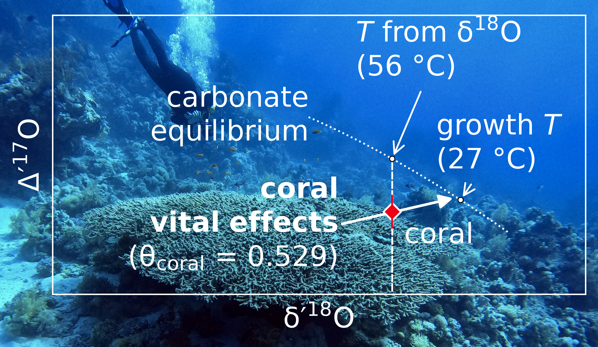

# Supplementary material for: Correcting for Vital Effects in Coral Carbonate Using Triple Oxygen Isotopes

## Graphical abstract

## Reference

> [!IMPORTANT]
> Bajnai, D., Klipsch, S., Davies, A. J., Raddatz, J., Gischler, E., Rüggeberg, A., Pack, A., & Herwartz, D. (2024). Correcting for vital effects in coral carbonate using triple oxygen isotopes. Geochemical Perspectives Letters, 31, 38-43. [10.7185/geochemlet.2430](https://doi.org/10.7185/geochemlet.2430)

>[!NOTE]
>If you use the data or scripts from this repository, please cite the associated Zenodo dataset:
>
>Bajnai, D., Klipsch, S., & Herwartz, D. (2024). Supplementary material for Correcting for vital effects in coral carbonate using triple oxygen isotopes [Dataset]. Zenodo. https://doi.org/10.5281/zenodo.13269294

## Codes

- [1_scale_data.py](codes/1_scale_data.py) scales and averages the TILDAS measurements. Input: [Table_S-2.csv](data/input/measured/Table_S-2.csv). Output: [Table_S-3_part-1.csv](data/output/Table_S-3_part-1.csv), [Figure_S2a.png](plots/Figure_S2a.png), [Figure_S2b.png](plots/Figure_S2b.png), [Figure_S2c.png](plots/Figure_S2c.png), [Figure_S3.png](plots/Figure_S3.png).
- [2_get_sw_parameters.py](codes/2_get_sw_parameters.py) estimates seawater conditions at the coral collection sites. Input: [Table_S-1_part-1.csv](data/input/measured/Table_S-1_part-1.csv), [Table_S-3_part-1.csv](data/output/Table_S-3_part-1.csv), [D18O_Breitkreuz_et_al_2018.nc](data/input/literature/D18O_Breitkreuz_et_al_2018.nc). Output: [Table_S-1.xlsx](data/output/Table_S-1.xlsx), [Table_S-3_part-2.csv](data/output/Table_S-3_part-2.csv), [Figure_S1.png](plots/Figure_S1.png).
- [3_calculate_thetas.py](codes/3_calculate_thetas.py) calculates coral vital-effect fractionation exponents. Input: [Table_S-3_part-2.csv](data/output/Table_S-3_part-2.csv), [isoDIC_header.csv](data/input/modeled/isoDIC_header.csv), [isoDIC_pH8.8_T9.csv](data/input/modeled/isoDIC_pH8.8_T9.csv), [isoDIC_pH8.5_T27.csv](data/input/modeled/isoDIC_pH8.5_T27.csv). Output: [Table_S-3_part-3.csv](data/output/Table_S-3_part-3.csv), [Figure_1.png](plots/Figure_1.png), [Figure_S5.png](plots/Figure_S5.png).
- [4_interpolate.py](codes/4_interpolate.py) reconstructs coral growth temperatures. Input: [Table_S-3_part-3.csv](data/output/Table_S-3_part-3.csv). Output: [Table_S-3.csv](data/output/Table_S-3.csv), [Table_S-3.xlsx](data/output/Table_S-3.xlsx), [Table_S-3_short.xlsx](data/output/Table_S-3_short.xlsx), [Figure_3.png](plots/Figure_3.png), [Figure_S6.png](plots/Figure_S6.png).
- [5_concept.py](codes/5_concept.py) illustrates the conceptual basis of the coral vital-effect correction. Input: [Table_S-3.csv](data/output/Table_S-3.csv), [seawater.csv](data/input/literature/seawater.csv), [background.jpeg](plots/background.jpeg). Output: [Figure_2.png](plots/Figure_2.png), [Graphical_Abstract.png](plots/Graphical_Abstract.png).
- [6_loops.py](codes/6_loops.py) illustrates the isoDIC model trajectories. Input: [isoDIC_header.csv](data/input/modeled/isoDIC_header.csv), [isoDIC_pH8.8_T9.csv](data/input/modeled/isoDIC_pH8.8_T9.csv), [isoDIC_pH8.5_T27.csv](data/input/modeled/isoDIC_pH8.5_T27.csv), [isoDIC_pH8.5_T9.csv](data/input/modeled/isoDIC_pH8.5_T9.csv), [isoDIC_pH8.8_T27.csv](data/input/modeled/isoDIC_pH8.8_T27.csv). Output: [Figure_S4.png](plots/Figure_S4.png).
- [7_absorption.py](codes/7_absorption.py) illustrates the isotope effects of CO2 absorption. Input: none. Output: [Figure_S7.png](plots/Figure_S7.png).
- [8_calibration_sensitivity.py](codes/8_calibration_sensitivity.py) assesses the sensitivity of coral isotope disequilibrium to equilibrium calibrations. Input: [Table_S-3_part-2.csv](data/output/Table_S-3_part-2.csv). Output: [Figure_S8.png](plots/Figure_S8.png).
- [_helper_functions.py](codes/_helper_functions.py) provides the shared isotope calculations.
- [_plot_style.py](codes/_plot_style.py) provides shared plot settings, colors, PNG export, and image combination.

Elements of [2_get_sw_parameters.py](codes/2_get_sw_parameters.py) are based on [isoForam](https://github.com/mdaeron/isoForam) by Daëron & Gray (2023).

## Data files

### Input data files

- [Table_S-1_part-1.csv](data/input/measured/Table_S-1_part-1.csv) contains coral collection-site information and measured growth conditions. It is used by [2_get_sw_parameters.py](codes/2_get_sw_parameters.py).
- [Table_S-2.csv](data/input/measured/Table_S-2.csv) contains the original TILDAS replicate measurements of coral samples and reference materials. It is used by [1_scale_data.py](codes/1_scale_data.py).
- [isoDIC_header.csv](data/input/modeled/isoDIC_header.csv) defines the dissolved inorganic carbon species and isotope quantities in the isoDIC model results. It is used by [3_calculate_thetas.py](codes/3_calculate_thetas.py) and [6_loops.py](codes/6_loops.py).
- [isoDIC_pH8.8_T9.csv](data/input/modeled/isoDIC_pH8.8_T9.csv) contains modeled dissolved inorganic carbon isotope evolution at pH 8.8 and 9 °C. It is used by [3_calculate_thetas.py](codes/3_calculate_thetas.py) and [6_loops.py](codes/6_loops.py).
- [isoDIC_pH8.5_T27.csv](data/input/modeled/isoDIC_pH8.5_T27.csv) contains modeled dissolved inorganic carbon isotope evolution at pH 8.5 and 27 °C. It is used by [3_calculate_thetas.py](codes/3_calculate_thetas.py) and [6_loops.py](codes/6_loops.py).
- [isoDIC_pH8.5_T9.csv](data/input/modeled/isoDIC_pH8.5_T9.csv) contains modeled dissolved inorganic carbon isotope evolution at pH 8.5 and 9 °C. It is used by [6_loops.py](codes/6_loops.py).
- [isoDIC_pH8.8_T27.csv](data/input/modeled/isoDIC_pH8.8_T27.csv) contains modeled dissolved inorganic carbon isotope evolution at pH 8.8 and 27 °C. It is used by [6_loops.py](codes/6_loops.py).

### Exported data files

- [Table_S-3_part-1.csv](data/output/Table_S-3_part-1.csv) contains averaged and corrected coral triple oxygen isotope measurements. It is generated by [1_scale_data.py](codes/1_scale_data.py) and used by [2_get_sw_parameters.py](codes/2_get_sw_parameters.py).
- [Table_S-3_part-2.csv](data/output/Table_S-3_part-2.csv) contains coral isotope measurements combined with seawater growth conditions. It is generated by [2_get_sw_parameters.py](codes/2_get_sw_parameters.py) and used by [3_calculate_thetas.py](codes/3_calculate_thetas.py) and [8_calibration_sensitivity.py](codes/8_calibration_sensitivity.py).
- [Table_S-3_part-3.csv](data/output/Table_S-3_part-3.csv) contains coral isotope offsets from equilibrium and vital-effect fractionation exponents. It is generated by [3_calculate_thetas.py](codes/3_calculate_thetas.py) and used by [4_interpolate.py](codes/4_interpolate.py).
- [Table_S-3.csv](data/output/Table_S-3.csv) contains the processed coral isotope results and reconstructed growth temperatures. It is generated by [4_interpolate.py](codes/4_interpolate.py) and used by [5_concept.py](codes/5_concept.py).

### Literature data used in the scripts

- [seawater.csv](data/input/literature/seawater.csv) contains published triple oxygen isotope measurements of seawater. Source: [Luz and Barkan (2010)](https://doi.org/10.1016/j.gca.2010.08.016), [Lin et al. (2021)](https://doi.org/10.1021/acsearthspacechem.1c00187).

> [!WARNING]
>A newer publication revisiting the Lin et al. (2021) seawater data is available: [Lin et al. (2025)](https://doi.org/10.1021/acsearthspacechem.5c00135). The 2025 publication reports a revised seawater ∆'17O value of -5 ppm, which is 6 ppm higher than the value used in this study.

The gridded seawater dataset is excluded from version control. Download the NetCDF data from [Breitkreuz et al. (2018)](https://doi.org/10.1594/PANGAEA.889922) and save the file as [D18O_Breitkreuz_et_al_2018.nc](data/input/literature/D18O_Breitkreuz_et_al_2018.nc) in [data/input/literature/](data/input/literature/).

## Changelog

- 2026-11-03: Improvements to codebase and maintainability. The scientific calculationsl, data imports and exports, and figures remain unchanged. Added a new figure [Figure S8](plots/Figure_S8.png), which assesses the sensitivity of coral isotope disequilibrium to equilibrium calibrations..

## License

All files in this repository are available under CC0 1.0. No rights reserved.
